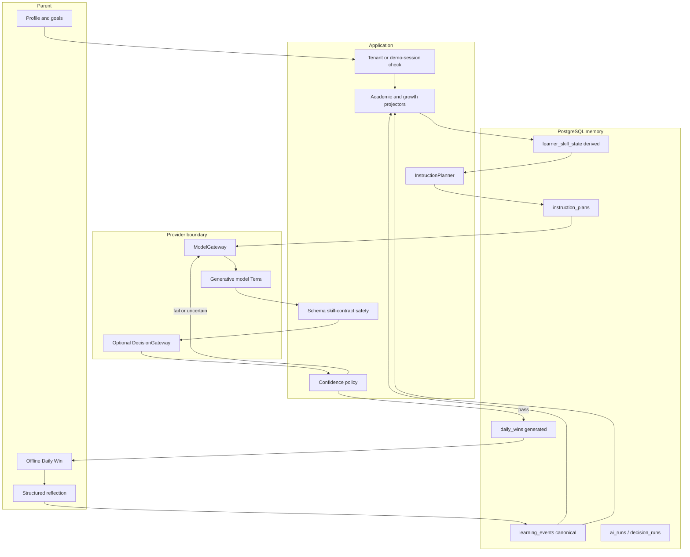

# Daily Win — AI architecture (V0.3)

Daily Win is not a chatbot with a database bolted on. Application code owns learning. The generative model owns the activity experience.

## High-level flow



Bounded workflow, not an agent loop:

```
deterministic code
  → one generative render
  → deterministic validation
  → optional typed verification
  → regenerate at most 2 more times (hard max 3 attempts)
```

Do not introduce `LLM → tool → LLM → tool → …` unless evaluation proves it materially improves results.

## Boundaries

| Abstraction | Speaks to | Required? |
| --- | --- | --- |
| `ModelGateway` | Generative LLM (OpenAI Responses, `store=False`) | Yes for generation |
| `DecisionGateway` | Typed decision models (Fake today; Jev-like later) | No |
| Mobile app | Daily Win HTTP API only | Yes; never a provider SDK |

Tenant / demo-session authorization happens **before** child information is sent to any provider.

## Model routing (`model_routing_v1`)

`route_generator` currently always returns Terra (`gpt-5.6-terra`).

Future, eval-gated only:

- simple, well-specified InstructionPlan → Luna
- complex / unusual plan → Terra
- failed / uncertain verification → stronger evaluator (`route_evaluator`)

Do not switch models because a SKU is cheaper or newer. See [model-evaluation.md](model-evaluation.md).

## Prompt architecture

Historical prompts are **immutable source files**:

- `daily_win_generator_v1`
- `daily_win_generator_v2`
- `daily_win_generator_v3`
- `daily_win_generator_v4`

Current: **`daily_win_generator_v5`**. Input schema version `"4"`. Historical v1–v4 remain frozen.

v5 receives only:

1. Profile context needed for engagement (nickname + parent-reported baseline).
2. Authoritative `InstructionPlan`, including derived `renderer_contracts`.
3. Bounded evidence summaries (max 6 application-written sentences).
4. Recent themes (max 3 titles).
5. Allowlists (planned skill codes, materials).

The LLM may choose framing, theme implementation, wording, playful mechanics, and concise coaching.

The LLM may **not** change target skill, intended difficulty, scaffold, assessment objective, success criteria, evidence requirement, or safety rules. Application code rejects `primary_skill_code != plan.primary_skill_code` and deterministic renderer-contract failures.

## Prompt-context minimization

| Field sent to renderer | Why required |
| --- | --- |
| `nickname` | Address the child without pronouns |
| `age_years`, `grade` | Age-appropriate wording |
| `interests`, `motivators` | Engagement theme (must not change the skill) |
| `preferred_activity_minutes` | Duration already clamped in the plan; kept so copy matches parent expectation |
| `strengths`, `current_difficulties`, `response_to_difficulty` | Still sent for cautious wording. **Re-justify with eval**; instructional difficulty already lives in the plan |
| `instruction_plan.*` | Authoritative teaching decision |
| `instruction_plan.renderer_contracts` | Derived structural rules for this plan (not learner truth) |
| `bounded_evidence_summaries` | Prevent repeating a story the parent already told; reporting_kind labeled | 
| `recent_themes` | Novelty |
| `allowed_skill_codes` | Contract check |
| `allowed_materials` | Safety / household constraint |

Never sent:

- Database IDs, demo session IDs, household IDs
- Entire historical event rows
- Arbitrary parent notes (`what_helped`, `additional_note`)
- Complete prior activity JSON
- Internal security metadata, API keys
- Peer percentiles (there is no such field)
- Goal UUIDs, learner-state UUIDs

IDs remain in `ai_runs.context_manifest` only.

Removed from the v3 renderer payload (no longer in `DailyWinModelContext`):

- Full active-goal list (replaced by the plan)
- Derived skill-state trend objects
- Full prior Daily Win objectives
- Separate `AdaptationDirective` object (growth copy now sits on the plan)

## Generated artifact vs plan

`daily_wins.primary_skill_id` is the **planned** skill, not whatever the model first attempted. `instruction_plan_id` links the artifact to the decision record.

Old Daily Win JSONB remains readable: content schema version is stored on the row; prompt version is stored on `ai_runs`. v1/v2/v3 prompt modules stay in tree.

## Safety stack (application-owned)

1. Prompt rules (not a control).
2. Structured output schema (`DailyWinDraft`).
3. Skill-contract + material allowlist.
4. Deterministic physical-safety validator.
5. Optional content moderator (off by default).
6. Optional DecisionGateway atomic checks.
7. Persist only after pass; rejected attempts record sanitized `ai_runs`.

## Storage notes

Relational columns for ownership, identity, lineage, categorical values, and queryable measurements.

Versioned JSONB for generated activity contracts, planner payloads, and provider-specific decision output.

Never one giant mutable learner-profile JSON blob.

See [learner-model.md](learner-model.md), [instruction-policy.md](instruction-policy.md), and [decision-intelligence.md](decision-intelligence.md).
